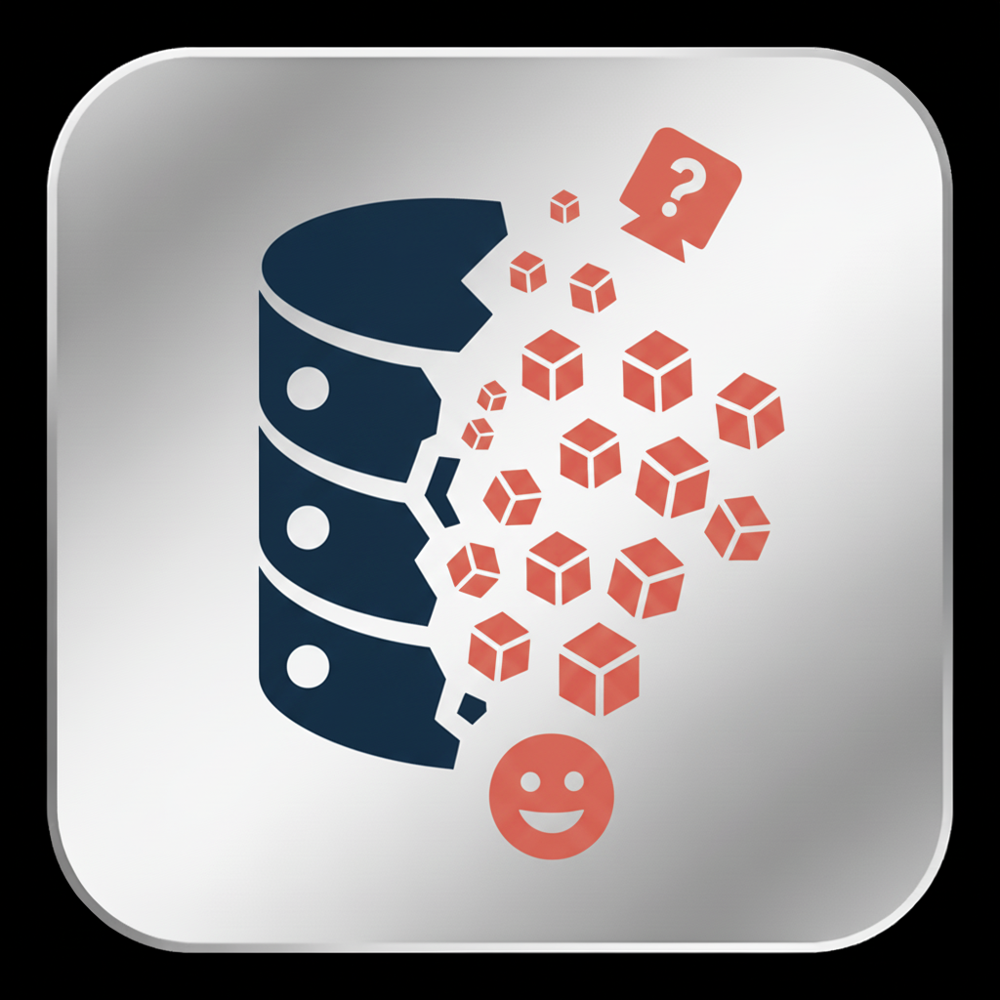

<div align="center">
  
  <h1>AbsurderSQL</h1>
  <p><strong>Rust + WASM + SQLite + IndexedDB/OPFS</strong></p>
  
  [](https://www.npmjs.com/package/@npiesco/absurder-sql)
  [](https://www.npmjs.com/package/@npiesco/absurder-sql)
  [](https://crates.io/crates/absurder-sql)
  [](https://crates.io/crates/absurder-sql)
</div>

You need SQLite in the browser, but you also need its data to survive a restart,
move into a normal `.db` file, and disappear from storage when you delete it.

**AbsurderSQL gives SQLite persistent browser storage and portable files.**

Serve this checkout over HTTP and run this as a browser ES module. This example
has one database owner; a multi-tab application needs coordinated writes.

```javascript
import init, { Database } from './pkg/absurder_sql.js';

await init();
const db = await Database.newDatabase('notes.db');
await db.allowNonLeaderWrites(true); // This example is the only writer.
try {
  await db.execute(
    'CREATE TABLE IF NOT EXISTS notes (id INTEGER PRIMARY KEY, body TEXT)'
  );
  await db.executeWithParams('INSERT INTO notes(body) VALUES (?)', [
    { type: 'Text', value: 'Saved locally' },
  ]);
  await db.sync();
  const result = await db.execute('SELECT id, body FROM notes ORDER BY id');
  console.log(result.rows.map(row => row.values.map(cell => cell.value)));
  const sqliteFile = await db.exportToFile();
  console.log('SQLite file bytes:', sqliteFile.byteLength);
} finally {
  await db.close();
  db.free();
}
```

Browser quotas, eviction policy, private browsing, and storage permissions still
apply. Await persistence operations and handle rejection; keep exported backups
outside the origin when the data matters. IndexedDB works on the main thread;
OPFS synchronous access requires a supported worker context.

> **Release status:** The fixes and qualified artifacts described here are on
> this branch and have not yet been published as a new Cargo or npm version.
> Package installation retrieves the published release, not unpublished changes.

**Tech Stack:**  
[](Cargo.toml)
[](https://webassembly.org/)
[](https://www.sqlite.org/)
[](https://developer.mozilla.org/en-US/docs/Web/API/IndexedDB_API)
[](docs/HYBRID_OPFS_PLAN.md)

**Capabilities:**
[](docs/DUAL_MODE.md)
[](absurder-sql-mobile/)
[](docs/EXPORT_IMPORT.md)
[](#telemetry-optional)
[](monitoring/prometheus/)
[](monitoring/grafana/)
[](browser-extension/)

## Why This Exists

A custom SQLite VFS maps database I/O onto 4 KiB blocks rather than serializing
the entire file for each write. IndexedDB stores blocks directly; Hybrid uses
OPFS blocks with IndexedDB metadata and recovery data. Native applications use
filesystem-backed SQLite, and the separate mobile bindings expose SQLite and
optional SQLCipher through UniFFI.

The point: use SQL for local data, coordinate its writers, and keep an ordinary
SQLite file available for backup or migration. [Export/import](docs/EXPORT_IMPORT.md),
[multi-tab coordination](docs/MULTI_TAB_GUIDE.md), the [PWA](pwa/), and optional
[telemetry](monitoring/README.md) are separate parts of that workflow.

## Browser Storage Backends

AbsurderSQL now exposes three browser constructors so you can choose persistence behavior explicitly:

- `Database.newDatabase(name)` uses the default IndexedDB-backed browser path and works on the main thread.
- `Database.newDatabaseAuto(name)` probes for OPFS `SyncAccessHandle` support and selects `Hybrid` in supported worker contexts, otherwise falls back to IndexedDB.
- `Database.newDatabaseWithBackend(name, 'IndexedDB' | 'OPFS' | 'Hybrid')` forces a specific backend.
- `db.getStorageBackend()` returns the backend actually in use.

`Hybrid` is the recommended worker backend: blocks live in OPFS for fast block I/O, while IndexedDB stores metadata and provides fallback durability. Main-thread browser code should continue using IndexedDB or rely on `newDatabaseAuto()` to fall back automatically.

```javascript
import init, { Database } from '@npiesco/absurder-sql';

await init();

const autoDb = await Database.newDatabaseAuto('app-auto');
console.log(autoDb.getStorageBackend());
await autoDb.close();
autoDb.free();
```

Run `newDatabaseWithBackend(name, 'Hybrid')` in a worker, not in the main-thread
example above. Explicit backend requests reject unavailable storage; automatic
selection and recovery after an actual persistence failure are different cases.

## Storage and SQLite Contracts

- `execute()` and `executeWithParams()` preserve embedded-NUL text and BLOB
  bytes, including empty values. Results use `columns`, `rows[].values`,
  `affectedRows`, and `lastInsertId`; read-only statements do not inherit stale
  write counts. Invalid UTF-8 stored as SQLite TEXT is rejected rather than
  silently replaced.
- `sync()` rejects persistence failures. A successful in-memory SQL statement
  is not a substitute for successful durable synchronization.
- `exportToFile()` requires a complete SQLite checkpoint and returns a
  standalone rollback-format snapshot. The live database stays in WAL mode.
- `Database.deleteDatabase(name)` removes the exact physical database
  namespace, including its IndexedDB blocks and OPFS state, without deleting
  prefix-sharing neighbors. Close every handle in every runtime first.

```javascript
import init, { Database } from './pkg/absurder_sql.js';

await init();
// All tabs and workers using this name must already have closed their handles.
await Database.deleteDatabase('notes.db');
```

Deletion rejects storage failures; it is not atomic across all browser stores,
so an error can leave partially applied cleanup. It does not erase the whole
origin or replace physical deletion with `DROP TABLE`. See the
[stabilization contract](docs/SQLITE_STABILIZATION.md) and
[native qualification record](docs/NATIVE_QUALIFICATION.md).

## Tri-Mode Architecture

AbsurderSQL runs in **three modes** - Browser (WASM), Native (Rust CLI/Server), and Mobile (React Native):

```mermaid
graph TB
    subgraph "Browser Environment (WASM)"
        JS["JavaScript/TypeScript<br/>Web Application"]
        WASM["WASM Bridge<br/>(wasm-bindgen)"]
    end
    
    subgraph "Native Environment (Rust)"
        CLI["CLI/Server<br/>Application"]
        NATIVE_DB["Native Database API<br/>(database.rs)"]
    end

    subgraph "Mobile Environment (React Native)"
        RN["React Native App<br/>(TypeScript)"]
        UNIFFI["UniFFI Bridge<br/>(Swift/Kotlin)"]
    end
    
    subgraph "AbsurderSQL Core (Rust)"
        DB["Database API<br/>(lib.rs)"]
        SQLITE["SQLite Engine<br/>(sqlite-wasm-rs / rusqlite)"]
        VFS["Custom VFS Layer<br/>(indexeddb_vfs.rs)"]
        
        subgraph "Storage Layer"
            BS["BlockStorage<br/>(block_storage.rs)"]
            SYNC["Sync Operations<br/>(sync_operations.rs)"]
            META["Metadata Manager<br/>(metadata.rs)"]
            CACHE["LRU Cache<br/>(128 blocks)"]
            ALLOC["Allocation<br/>(allocation.rs)"]
            EXPORT["Export<br/>(export.rs)"]
            IMPORT["Import<br/>(import.rs)"]
        end
        
        subgraph "Multi-Tab Coordination (Browser Only)"
            LEADER["Leader Election<br/>(leader_election.rs)"]
            BCAST["BroadcastChannel<br/>(broadcast_notifications.rs)"]
            QUEUE["Write Queue<br/>(write_queue.rs)"]
        end
        
        subgraph "Monitoring & Recovery"
            OBS["Observability<br/>(observability.rs)"]
            RECOVERY["Recovery<br/>(recovery.rs)"]
        end
    end
    
    subgraph "Browser Persistence"
      INDEXEDDB["IndexedDB<br/>(Browser Storage)"]
      OPFS["OPFS<br/>(Worker SyncAccessHandle)"]
      LOCALSTORAGE["localStorage<br/>(Coordination)"]
    end
    
    subgraph "Native Persistence"
        FILESYSTEM["Filesystem<br/>(Traditional .db files)"]
        BLOCKS["./absurdersql_storage/<br/>database.sqlite + blocks/"]
    end

    subgraph "Mobile Persistence"
        DEVICE_FS["Device Filesystem<br/>(iOS/Android Storage)"]
        SQLCIPHER["SQLCipher<br/>(AES-256 Encryption)"]
    end
    
    subgraph "Telemetry Stack (optional --features telemetry)"
        PROM["Prometheus<br/>(Metrics)"]
        OTEL["OpenTelemetry<br/>(Traces)"]
        GRAFANA["Grafana Dashboards"]
        ALERTS["Alert Rules"]
        DEVTOOLS["DevTools Extension<br/>(Chrome/Firefox)"]
    end
    
    JS -->|execute/query| WASM
    WASM -->|calls| DB
    CLI -->|execute/query| NATIVE_DB
    NATIVE_DB -->|SQL| SQLITE
    RN -->|execute/query| UNIFFI
    UNIFFI -->|calls| DB
    DB -->|SQL| SQLITE
    DB -->|exportToFile| EXPORT
    DB -->|importFromFile| IMPORT
    SQLITE -->|VFS calls| VFS
    VFS -->|block I/O| BS
    BS -->|read/write| CACHE
    BS -->|allocate| ALLOC
    BS -->|persist| SYNC
    SYNC -->|metadata| META
    EXPORT -->|read blocks| BS
    IMPORT -->|write blocks| BS
    BS -->|"WASM IndexedDB"| INDEXEDDB
    BS -->|"WASM Hybrid/OPFS"| OPFS
    BS -->|"Native mode"| FILESYSTEM
    NATIVE_DB -->|"fs_persist"| BLOCKS
    UNIFFI -->|"Mobile mode"| DEVICE_FS
    DEVICE_FS -->|"encryption"| SQLCIPHER
    BS -->|metrics| OBS
    LEADER -->|atomic ops| LOCALSTORAGE
    LEADER -->|notify| BCAST
    QUEUE -->|forward| BCAST
    OBS -->|"--features telemetry"| PROM
    OBS -->|"--features telemetry"| OTEL
    PROM -->|scrape| GRAFANA
    PROM -->|evaluate| ALERTS
    OTEL -->|spans| DEVTOOLS
    
    style SQLITE fill:#a855f7,stroke:#333,color:#fff
    style VFS fill:#3b82f6,stroke:#333,color:#fff
    style BS fill:#fbbf24,stroke:#333,color:#000
    style EXPORT fill:#ec4899,stroke:#333,color:#fff
    style IMPORT fill:#8b5cf6,stroke:#333,color:#fff
    style INDEXEDDB fill:#22c55e,stroke:#333,color:#000
    style OPFS fill:#14b8a6,stroke:#333,color:#fff
    style QUEUE fill:#ef4444,stroke:#333,color:#fff
    style OBS fill:#92400e,stroke:#333,color:#fff
    style PROM fill:#1c1c1c,stroke:#333,color:#fff
    style GRAFANA fill:#f97316,stroke:#333,color:#fff
    
    %% Default styling for uncolored blocks (light gray)
    style JS fill:#d1d5db,stroke:#333,color:#000
    style WASM fill:#d1d5db,stroke:#333,color:#000
    style CLI fill:#d1d5db,stroke:#333,color:#000
    style NATIVE_DB fill:#d1d5db,stroke:#333,color:#000
    style DB fill:#d1d5db,stroke:#333,color:#000
    style SYNC fill:#d1d5db,stroke:#333,color:#000
    style META fill:#d1d5db,stroke:#333,color:#000
    style CACHE fill:#d1d5db,stroke:#333,color:#000
    style ALLOC fill:#d1d5db,stroke:#333,color:#000
    style LEADER fill:#d1d5db,stroke:#333,color:#000
    style BCAST fill:#d1d5db,stroke:#333,color:#000
    style RECOVERY fill:#d1d5db,stroke:#333,color:#000
    style LOCALSTORAGE fill:#d1d5db,stroke:#333,color:#000
    style FILESYSTEM fill:#d1d5db,stroke:#333,color:#000
    style BLOCKS fill:#d1d5db,stroke:#333,color:#000
    style RN fill:#61dafb,stroke:#333,color:#000
    style UNIFFI fill:#10b981,stroke:#333,color:#fff
    style DEVICE_FS fill:#d1d5db,stroke:#333,color:#000
    style SQLCIPHER fill:#f59e0b,stroke:#333,color:#000
    style OTEL fill:#d1d5db,stroke:#333,color:#000
    style ALERTS fill:#d1d5db,stroke:#333,color:#000
    style DEVTOOLS fill:#d1d5db,stroke:#333,color:#000
```


## Project Structure

```
absurder-sql/
├── src/
│   ├── lib.rs              # WASM entry point, Database API exports
│   ├── database.rs         # Native Database implementation
│   ├── types.rs            # Core types (QueryResult, ColumnValue, etc.)
│   ├── utils.rs            # Utility functions
│   ├── wasm_statement.rs   # WASM statement ownership, binding, and row decoding
│   │
│   ├── bin/                # Binary executables
│   │   └── cli_query.rs    # CLI query tool for filesystem databases
│   │
│   ├── storage/            # Storage layer implementation
│   │   ├── mod.rs
│   │   ├── block_storage.rs           # Core block storage with LRU cache
│   │   ├── sync_operations.rs        # Cross-platform sync logic
│   │   ├── io_operations.rs          # Read/write operations
│   │   ├── allocation.rs             # Block allocation/deallocation
│   │   ├── metadata.rs               # Block metadata management
│   │   ├── export.rs                 # Database export to SQLite files
│   │   ├── import.rs                 # Database import from SQLite files
│   │   ├── retry_logic.rs            # Retry logic for transient failures
│   │   ├── fs_persist.rs             # Native filesystem persistence
│   │   ├── backend_detect.rs         # Browser backend auto-detection
│   │   ├── wasm_indexeddb.rs         # WASM IndexedDB integration
│   │   ├── wasm_opfs.rs              # WASM OPFS block storage bridge
│   │   ├── hybrid_store.rs           # Hybrid OPFS + IndexedDB orchestration
│   │   ├── wasm_vfs_sync.rs          # WASM VFS sync coordination
│   │   ├── recovery.rs               # Crash recovery logic
│   │   ├── auto_sync.rs              # Native auto-sync
│   │   ├── wasm_auto_sync.rs         # WASM auto-sync
│   │   ├── leader_election.rs        # Multi-tab leader election
│   │   ├── broadcast_notifications.rs # BroadcastChannel messaging
│   │   ├── write_queue.rs            # Write queuing for non-leaders
│   │   ├── optimistic_updates.rs     # Optimistic UI updates
│   │   ├── coordination_metrics.rs   # Performance metrics tracking
│   │   ├── observability.rs          # Metrics and monitoring
│   │   └── constructors.rs           # BlockStorage constructors
│   │
│   └── vfs/                # SQLite VFS implementation
│       ├── mod.rs
│       └── indexeddb_vfs.rs     # Custom VFS for IndexedDB
│
├── tests/                  # Comprehensive test suite
│   ├── integration_tests.rs          # End-to-end tests
│   ├── native_database_persistence_tests.rs  # Native filesystem tests
│   ├── wasm_integration_tests.rs     # WASM-specific tests (inc. export/import)
│   ├── export_import_examples_test.rs # Export/import validation tests
│   ├── export_import_lock_tests.rs   # Export/import locking tests
│   ├── vfs_durability_tests.rs       # VFS durability tests
│   ├── lru_cache_tests.rs            # Cache tests
│   ├── e2e/                          # Playwright E2E tests
│   │   ├── dual_mode_persistence.spec.js  # Browser + CLI validation
│   │   ├── worker-hybrid-opfs.spec.js     # Worker Hybrid/OPFS durability coverage
│   │   ├── benchmark-page.spec.js         # Benchmark page smoke coverage
│   │   ├── advanced-features.spec.js
│   │   └── multi-tab-vite.spec.js
│   └── ...                           # Backend and regression integration tests
│
├── pwa/                    # Production Next.js PWA
│   ├── app/                # Application routes, including the database UI
│   ├── lib/db/             # SharedWorker coordinator, runtime worker, typed proxy
│   ├── public/sw.js        # Offline service worker and production asset cache
│   ├── e2e/                # Production PWA Playwright coverage
│   └── playwright.pwa.config.ts # Serial next build/start test configuration
│
├── examples/               # Browser demos and documentation
│   ├── vite-app/           # Production Vite application
│   ├── export_import_demo.html        # Export/import 4-step wizard demo
│   ├── export_import.js               # Export/import examples
│   ├── test_export_import_examples.html # Export/import test suite
│   ├── sql_demo.html       # Interactive SQL demo page
│   ├── web_demo.html       # Full-featured web interface
│   ├── benchmark.html      # Performance comparison tool
│   ├── absurder-benchmark-worker.js # Worker benchmark runner for Hybrid backend
│   ├── multi-tab-demo.html # Multi-tab coordination demo
│   ├── worker-example.html # Web Worker demo
│   ├── worker-db.js        # Web Worker implementation
│   ├── devtools_demo.html  # DevTools extension telemetry demo
│   └── DEMO_GUIDE.md       # Demo usage guide
│
├── docs/                   # Comprehensive documentation
│   ├── EXPORT_IMPORT.md    # Export/import guide (DATABASE PORTABILITY)
│   ├── DUAL_MODE.md        # Tri-mode persistence guide
│   ├── MULTI_TAB_GUIDE.md  # Multi-tab coordination
│   ├── HYBRID_OPFS_PLAN.md # Hybrid OPFS implementation status and validation
│   ├── TRANSACTION_SUPPORT.md # Transaction handling
│   ├── BENCHMARK.md        # Performance benchmarks
│   ├── ENCRYPTION.md       # SQLCipher encryption guide
│   ├── CODING_STANDARDS.md # Development best practices
│   ├── REMAINING_UNWRAPS.md # Unwrap safety analysis
│   ├── SQLITE_STABILIZATION.md # SQLite and durability contracts
│   ├── NATIVE_QUALIFICATION.md # Mac and Windows results and retained failures
│   ├── SELF_HOSTED_CI.md   # Runner admission and release workflow
│   └── mobile/             # Mobile-specific documentation
│       ├── INSTRUCTIONS.md     # Mobile build instructions
│       └── MOBILE_BENCHMARK.md # Mobile performance benchmarks
│
├── monitoring/             # Observability templates (optional --features telemetry)
│   ├── grafana/dashboards/ # Grafana dashboard templates
│   │   ├── overview.json
│   │   ├── performance.json
│   │   ├── multi-tab.json
│   │   └── errors.json
│   ├── prometheus/         # Alert rules and recording rules
│   │   ├── alerts.yml
│   │   └── recording_rules.yml
│   └── RUNBOOK.md          # Alert runbooks and remediation procedures
│
├── browser-extension/      # Browser DevTools extension (Chrome/Firefox)
│   ├── manifest.json       # Manifest V3 extension configuration
│   ├── devtools.js         # Message hub (devtools page)
│   ├── content.js          # Content script (page bridge)
│   ├── panel.html/css/js   # DevTools panel UI
│   ├── icons/              # Extension icons (16, 48, 128)
│   ├── README.md           # Extension features and architecture
│   └── INSTALLATION.md     # Installation guide
│
├── absurder-sql-mobile/    # React Native bindings (iOS + Android)
│   ├── src/
│   │   ├── uniffi_api/     # UniFFI exported functions
│   │   │   ├── core.rs     # Exported database operations
│   │   │   └── types.rs    # QueryResult, DatabaseConfig, etc.
│   │   ├── AbsurderDatabase.ts  # High-level TypeScript API
│   │   └── lib.rs          # Crate entry point
│   ├── android/            # Android-specific (Kotlin bindings, SQLCipher libs)
│   ├── ios/                # iOS-specific (Swift bindings)
│   ├── react-native/       # Test app for iOS/Android
│   ├── scripts/            # Build helper scripts
│   └── README.md           # Mobile setup guide
│
├── pkg/                    # WASM build output (generated)
├── Cargo.toml             # Rust dependencies and config
├── package.json           # Node.js dependencies
└── README.md              # This file
```

## System Architecture

### Core Architecture
The project follows a modular architecture with clear separation of concerns:

**VFS Layer**: Implements a custom SQLite Virtual File System that translates SQLite's file operations to IndexedDB operations. This allows SQLite to work seamlessly with browser storage without modifications to the core SQLite engine.

**Storage Abstraction**: Implements IndexedDB, OPFS, and Hybrid browser backends,
with a separate native filesystem path.

**WASM Bridge**: Uses `sqlite-wasm-rs` and a shared statement owner to finalize
prepared statements on success and failure. Binding and row decoding use
explicit byte lengths for text and BLOBs; asynchronous storage ownership does
not escape through fabricated mutable references.

**Type System**: Defines comprehensive data structures for SQL operations, query results, and configuration options, ensuring type safety across the Rust-JavaScript boundary.

### Frontend Architecture
The web demo uses vanilla JavaScript with Bootstrap for styling, demonstrating real-time SQL query execution and result visualization. The frontend architecture emphasizes simplicity and direct WASM integration without complex frameworks.

### Data Storage Design
**Primary Storage**: IndexedDB serves as the persistent storage layer, chosen for its transaction support, large storage capacity, and widespread browser compatibility.

**Memory Management**: The library implements careful memory management for WASM operations, ensuring proper cleanup of allocated memory and efficient data transfer between Rust and JavaScript contexts.

**Transaction Handling**: Leverages SQLite's transaction capabilities while ensuring proper coordination with IndexedDB's transaction model for data consistency.

### Configuration System
The architecture supports configurable database options including cache size, synchronization modes, and VFS-specific settings, allowing optimization for different use cases and performance requirements.

---

## Export/Import: Full Database Portability

Export a database as a SQLite file, or replace an open database with validated
SQLite file bytes. These operations do not depend on a server.

### Why This Matters

With AbsurderSQL, your data is **never locked in the browser**. You can:

- **Export** databases as standard SQLite files
- **Import** databases from SQLite files
- **Backup** your data with one function call
- **Migrate** databases between devices and browsers
- **Debug** exported files with sqlite3 CLI or DB Browser
- **Share** databases as downloadable files

Exports reject blocked or incomplete checkpoints rather than return an
uncertain snapshot. The returned file can be opened by native SQLite with
`mode=ro` without requiring `immutable=1`.

### Quick Example

```javascript
// From npm package
import init, { Database } from '@npiesco/absurder-sql';

// Or from local build
// import init, { Database } from './pkg/absurder_sql.js';

await init();
const db = await Database.newDatabase('myapp.db');
await db.waitForLeadership();

// Create some data
await db.execute('CREATE TABLE users (id INTEGER PRIMARY KEY, name TEXT)');
await db.execute("INSERT INTO users VALUES (1, 'Alice')");

// EXPORT: Get entire database as standard SQLite file
const exportedData = await db.exportToFile();

// Download for user
const blob = new Blob([exportedData], { type: 'application/octet-stream' });
const url = URL.createObjectURL(blob);
const a = document.createElement('a');
a.href = url;
a.download = 'myapp.db';
a.click();
setTimeout(() => URL.revokeObjectURL(url), 0);

// IMPORT: Assumes <input id="fileInput" type="file"> has a selected SQLite file.
const file = document.getElementById('fileInput').files[0];
const arrayBuffer = await file.arrayBuffer();
await db.importFromFile(new Uint8Array(arrayBuffer));

// Database is immediately usable after import (no reopen needed)
const result = await db.execute('SELECT * FROM users');
console.log(result.rows);
await db.close();
db.free();
```

### Interactive Demos

- **[Export/Import Demo](examples/export_import_demo.html)** - 4-step wizard with progress tracking
- **[Automated Tests](examples/test_export_import_examples.html)** - 5 validation tests
- **[Code Examples](examples/export_import.js)** - Export/import workflows

### Full Documentation

See **[docs/EXPORT_IMPORT.md](docs/EXPORT_IMPORT.md)** for:
- Complete API reference
- Architecture details
- Best practices & patterns
- Troubleshooting guide
- Size limits & performance

---

## Getting Started

### Installation

#### Option 1: Install from npm (Recommended)

```bash
npm install @npiesco/absurder-sql
```

Then use in your project:

```javascript
import init, { Database } from '@npiesco/absurder-sql';

// Initialize WASM
await init();

// Create database
const db = await Database.newDatabase('myapp.db');
await db.waitForLeadership();

// Use SQLite
await db.execute('CREATE TABLE users (id INTEGER PRIMARY KEY, name TEXT)');
await db.execute("INSERT INTO users VALUES (1, 'Alice')");
const result = await db.execute('SELECT * FROM users');

// Export for backup
const backup = await db.exportToFile();

// Close when done
await db.close();
db.free();
```

**Package includes:**
- Pre-built WASM binary (1,431,072 bytes in the qualified default build)
- TypeScript definitions
- All necessary JavaScript glue code
- Optional telemetry excluded from the default build

> **Note:** The npm package is built without the `telemetry` feature for smaller size and faster load times. If you need Prometheus/OpenTelemetry support for production monitoring, build from source with `--features telemetry`.

#### Option 2: Install from crates.io (Rust Projects)

Resolve the currently published crate into your project's manifest and lockfile:

```bash
cargo add absurder-sql
```

**Available on [crates.io](https://crates.io/crates/absurder-sql)** with full Rust documentation and dual-mode support (browser WASM + native CLI).

#### Option 3: Build from Source

For development or custom builds:

**Prerequisites:**
- Rust with the 2024 edition; the manifest declares 1.85.0, and this
  qualification used Rust 1.98.0.
- wasm-pack 0.14.0 and the `wasm32-unknown-unknown` target.
- Node.js 24 for the current development and PWA toolchain.

```bash
# Clone the repository
git clone https://github.com/npiesco/absurder-sql
cd absurder-sql

# Install the target and build tool if needed
rustup target add wasm32-unknown-unknown &&
cargo install wasm-pack --version 0.14.0 --locked &&
npm run build
```

This generates the `pkg/` directory containing:
- `absurder_sql.js` - JavaScript module
- `absurder_sql_bg.wasm` - WebAssembly binary
- TypeScript definitions and package files

Keep the tracked `pkg/LICENSE.md` when preparing a source copy. wasm-pack 0.14.0
uses existing output-directory license files to populate `package.json`; removing
that static input changes first-build versus rebuild metadata. `npm run build`
also synchronizes the matching runtime into `pwa/lib`.

### Optional Features

AbsurderSQL supports optional feature flags to minimize dependencies and binary size:

#### Telemetry (Optional)

**The npm package does NOT include telemetry** for minimal size. To enable telemetry features (Prometheus metrics, OpenTelemetry tracing), you must build from source with the `telemetry` feature flag:

```bash
# Build with telemetry support (Prometheus + OpenTelemetry)
wasm-pack build --target web --out-dir pkg --features telemetry

# Build without the optional telemetry feature
wasm-pack build --target web --out-dir pkg
```

**What telemetry provides:**
- Prometheus metrics (queries, errors, cache hits/misses, block operations)
- OpenTelemetry distributed tracing spans
- Performance monitoring and observability

**Dependencies (only when `telemetry` feature is enabled):**
- `prometheus` - Metrics collection
- `opentelemetry` - Distributed tracing
- `opentelemetry_sdk` - Tracing SDK
- `opentelemetry-prometheus` - Prometheus exporter

**When to use:**
- Production monitoring and observability
- Performance debugging and profiling
- Integration with Grafana/Prometheus stack
- Not needed for typical applications (default build excludes it)

**Exposing Metrics for Prometheus (Native Applications):**

The library does not start an HTTP metrics server. Wire a `Metrics` registry to
the storage or instrumentation you use, then expose it through your own server.
The native `Database` alias is `SqliteIndexedDB`; do not assume it has the
WASM-only database instrumentation methods. See
[monitoring setup](monitoring/README.md) for the component boundaries.

The optional WASM telemetry tests exercise actual queries, failures,
synchronization, and a loopback HTTP collector. The default build remains
telemetry-disabled.

### Observability Components

The repository includes optional telemetry components, dashboards, alert rules,
and a DevTools extension. Export endpoints and application wiring are configured
by the application.

**[Complete Monitoring Setup Guide](monitoring/README.md)** | **[Alert Runbook](monitoring/RUNBOOK.md)** | **[DevTools Extension](browser-extension/README.md)**

#### Grafana Dashboards (4 Dashboards, 28 Panels)

| Dashboard | Panels |
| --- | ---: |
| `monitoring/grafana/dashboards/overview.json` | 6 |
| `monitoring/grafana/dashboards/performance.json` | 7 |
| `monitoring/grafana/dashboards/multi-tab.json` | 7 |
| `monitoring/grafana/dashboards/errors.json` | 8 |

These are templates to adapt to your deployment, not automatically configured
application instrumentation. Some templates retain legacy histogram names;
match the current `_duration_ms_bucket` metrics and millisecond units before
enabling panels or alerts.

#### Alert Rules (16 Alerts + 25 Recording Rules)

Alert definitions are in `monitoring/prometheus/alerts.yml`; recording rules
are in `monitoring/prometheus/recording_rules.yml`. Configure scrape targets,
labels, thresholds, and notification routing for your application. The
[monitoring guide](monitoring/README.md) and
[runbook](monitoring/RUNBOOK.md) describe the current metric names and units.

#### Browser DevTools Extension

Chrome/Firefox extension for debugging WASM telemetry in the browser:

**Features:**
- Real-time span visualization with filtering
- Export statistics (success/failure rates)
- Manual flush trigger
- Buffer inspection
- OTLP endpoint configuration

**Architecture:** Manifest V3 compliant with proper message passing (page → content script → devtools hub → panel)

**Installation:**
1. Chrome: Load unpacked from `browser-extension/`
2. Firefox: Load temporary add-on from `browser-extension/manifest.json`

See `browser-extension/README.md` and `browser-extension/INSTALLATION.md` for complete setup instructions.

**Demo Page:** `examples/devtools_demo.html` generates sample telemetry for testing the extension.

#### Filesystem Persistence (Native Only)

Enable native filesystem persistence for CLI/server applications:

```bash
# Build with filesystem persistence
cargo build --features fs_persist

# Run tests with filesystem persistence
cargo test --features fs_persist
```

The `telemetry` feature gates the telemetry module and its optional dependencies.
Coordination diagnostics and normal logging are separate from that feature.

### Browser Usage (WASM)

```javascript
// From npm package
import init, { Database } from '@npiesco/absurder-sql';

// Or from local build
// import init, { Database } from './pkg/absurder_sql.js';

// Initialize WASM
await init();

// Create database - persists to IndexedDB
const db = await Database.newDatabase('myapp');
await db.waitForLeadership();

// Execute SQL
await db.execute('CREATE TABLE users (id INT, name TEXT)');
await db.execute("INSERT INTO users VALUES (1, 'Alice')");
const result = await db.execute('SELECT * FROM users');

// Persist to IndexedDB
await db.sync();

// Close
await db.close();
db.free();
```

### Web Worker Support

AbsurderSQL fully supports Web Workers for off-thread database operations, keeping your main thread responsive during heavy database work:

```javascript
// worker.js
import init, { Database } from '@npiesco/absurder-sql';

self.onmessage = async function(e) {
  // Initialize WASM in worker
  await init();
  
  const db = await Database.newDatabase('worker_db.db');
  
  // Workers don't have localStorage for leader election
  // Enable non-leader writes for worker context
  await db.allowNonLeaderWrites(true);
  
  // Perform database operations
  await db.execute('CREATE TABLE data (id INTEGER, value TEXT)');
  await db.execute("INSERT INTO data VALUES (1, 'processed in worker')");
  
  // Sync to IndexedDB
  await db.sync();
  
  const result = await db.execute('SELECT * FROM data');
  await db.close();
  db.free();
  
  // Send results back to main thread
  self.postMessage({ success: true, rows: result.rows });
};
```

```javascript
// main.js
const worker = new Worker('/worker.js', { type: 'module' });

worker.onmessage = (e) => {
  console.log('Worker result:', e.data);
};

worker.postMessage({ type: 'processData' });
```

**Key Points:**
- IndexedDB access works in both Window and Worker contexts
- Workers don't have `localStorage`; await `db.allowNonLeaderWrites(true)` only
  when that worker is the sole writer or an external coordinator serializes it.
- All database operations run off the main thread
- The one-request example above is not a multi-worker coordinator. Serialize
  operations when a worker receives multiple requests.

**Example:** See `examples/worker-example.html` for a complete working demo

### Production PWA (Hybrid OPFS + IndexedDB)

The checked-in [`pwa/`](pwa/) is a production Next.js PWA backed by AbsurderSQL's local WASM build. A `SharedWorker` coordinates tabs while one elected dedicated Worker owns and serializes the physical database runtime. The Hybrid backend stores blocks in OPFS, keeps coordination metadata and fallback data in IndexedDB, and reopens logical database handles after runtime handoff. The service worker precaches the emitted application, worker, WASM, JavaScript, and CSS assets for offline reload.

Build the local WASM package first, then start the PWA:

```bash
# Repository root: build WASM and sync it into pwa/lib
npm install
npm run build

cd pwa
npm install
npm run dev
```

These commands use your configured npm registry; do not add a direct public-registry override.

Run the production PWA storage suite:

```bash
cd pwa
npx playwright install chromium  # First run only
npm run test:pwa
```

`test:pwa` runs serially against `next build` and `next start`. It verifies Hybrid selection and reopen, two-tab shared ownership with continued writes after one tab closes, and offline reload from persisted OPFS data.

**Verified 2026-09-22:** all 3 production PWA scenarios passed on the original
Apple-runtime lane and the isolated Windows VM. See
[qualification](docs/NATIVE_QUALIFICATION.md) for the exact environments and
retained failed attempts. This is not a new npm audit result.

**Implementation provenance:** the PWA is an AbsurderSQL implementation by `npiesco`; it does not import Onyx source or packages. Onyx commits `d039d03`, `a4ecdea`, `417e23d`, `8a18a7c`, and `1d90c3c`, also by `npiesco`, supplied behavioral and production-test references. AbsurderSQL's Hybrid recovery, multi-tab coordination, and benchmark commits remain the implementation authority. See [**docs/HYBRID_OPFS_PLAN.md**](docs/HYBRID_OPFS_PLAN.md#pwa-integration-update-2026-07-25) for the per-section code and author references.

### Native/CLI Usage (Filesystem)

```bash
# Build the CLI tool
cargo build --bin cli_query --features fs_persist --release

# Create table
cargo run --bin cli_query --features fs_persist -- \
  "CREATE TABLE users (id INTEGER PRIMARY KEY, name TEXT, email TEXT)"

# Insert data
cargo run --bin cli_query --features fs_persist -- \
  "INSERT INTO users (name, email) VALUES ('Alice', 'alice@example.com')"

# Query data
cargo run --bin cli_query --features fs_persist -- \
  "SELECT * FROM users"

# Special commands
cargo run --bin cli_query --features fs_persist -- ".tables"
cargo run --bin cli_query --features fs_persist -- ".schema"
```

**Data Location:** `./absurdersql_storage/<db_name>/database.sqlite`

See [**docs/DUAL_MODE.md**](docs/DUAL_MODE.md) for complete tri-mode guide.

### Mobile Usage (React Native)

AbsurderSQL Mobile provides native SQLite for iOS and Android via UniFFI-generated bindings:

```typescript
import { openDatabase } from 'absurder-sql-mobile';

const mobileDb = await openDatabase({ name: 'myapp.db' });
try {
  await mobileDb.execute(
    'CREATE TABLE IF NOT EXISTS users (id INTEGER PRIMARY KEY, name TEXT)'
  );
  await mobileDb.execute("INSERT INTO users(name) VALUES ('Alice')");
  const result = await mobileDb.execute('SELECT * FROM users ORDER BY id');
  console.log(result.rows);
} finally {
  await mobileDb.close();
}
```

The mobile wrapper is a separate API from the browser `Database`: parameter
values, export paths, encryption configuration, transactions, and streaming are
documented in the [mobile guide](absurder-sql-mobile/README.md).

**Features:**
- SQLCipher AES-256 encryption (iOS uses CommonCrypto, Android uses pre-built OpenSSL)
- Prepared statements, batch operations, streaming queries
- Full export/import for backup/restore
- Type-safe from Rust to TypeScript via UniFFI

**Verified 2026-07-26:** the locked `uniffi-bindings` host matrix passes all 67 Rust integration tests. That includes all 9 real export/import cases: new-database restore, same-vault restore, encrypted round-trip, BLOB preservation, invalid handles, and missing files. The same matrix passes `cargo fmt` and `cargo clippy --all-targets -- -D warnings`.

That is the dated mobile host-matrix result, not a new device qualification.
The September qualification described below covers the core library and browser
PWA; it does not replace mobile platform testing.

**Setup:** See [**absurder-sql-mobile/README.md**](absurder-sql-mobile/README.md) for build instructions.

#### Mobile Development Environment Setup

Building mobile apps requires native toolchains and Rust cross-compilation targets. Follow these steps to set up your development environment:

**Prerequisites:**
- **Rust 1.85.0+** with iOS/Android targets
- **Xcode** (iOS) with Command Line Tools
- **Android Studio** (Android) with NDK

**1. Install Rust iOS targets:**
```bash
rustup target add aarch64-apple-ios aarch64-apple-ios-sim x86_64-apple-ios
```

**2. Build iOS bindings with UniFFI:**
```bash
cd absurder-sql-mobile
npx uniffi-bindgen-react-native build ios --and-generate
```

**3. Install CocoaPods dependencies:**
```bash
cd your-react-native-app/ios && pod install && cd ..
```

**4. Run on iOS Simulator:**
```bash
npx react-native run-ios --simulator="iPhone 16"
```

**Android Setup:**
```bash
# Install Rust Android targets
rustup target add aarch64-linux-android armv7-linux-androideabi x86_64-linux-android i686-linux-android

# Build Android bindings
cd absurder-sql-mobile
npx uniffi-bindgen-react-native build android --and-generate

# Run on Android Emulator
cd your-react-native-app && npx react-native run-android
```

> **Important:** The `uniffi-bindgen-react-native build` step compiles the Rust native library for the target platform and generates the TypeScript/Swift/Kotlin bindings. This must be run before `pod install` (iOS) or Gradle build (Android).

## Performance Features

AbsurderSQL includes several performance optimizations for high-throughput applications:

### Transaction-Deferred Sync

Native filesystem synchronization is deferred during transactions. For browser
code, commit the SQL transaction and await `sync()` before treating it as durable.

```javascript
// Continuing with an open, write-owning Database instance named db:
await db.execute('CREATE TABLE IF NOT EXISTS data (id INTEGER PRIMARY KEY, value TEXT)');
await db.execute('BEGIN TRANSACTION');
try {
  for (let i = 0; i < 1000; i++) {
    await db.executeWithParams('INSERT OR REPLACE INTO data VALUES (?, ?)', [
      { type: 'Integer', value: i },
      { type: 'Text', value: `value${i}` },
    ]);
  }
  await db.execute('COMMIT');
} catch (error) {
  await db.execute('ROLLBACK');
  throw error;
}
await db.sync();
```

### Batch Execution

Native Rust exposes `SqliteIndexedDB::execute_batch`, and the mobile wrapper has
its own batch API. The browser `Database` does **not** expose `executeBatch`;
use sequential `execute` or `executeWithParams` calls inside a transaction.

### Prepared Statements (Native Only)

Eliminate SQL re-parsing overhead for repeated queries:

```rust
// Native/CLI usage only (not available in WASM)
use absurder_sql::{SqliteIndexedDB, DatabaseConfig, ColumnValue};

// Inside an async function returning Result<_, DatabaseError>:
let config = DatabaseConfig {
    name: "prepared.db".into(),
    ..DatabaseConfig::default()
};
let mut db = SqliteIndexedDB::new(config).await?;
db.execute("CREATE TABLE IF NOT EXISTS users (id INTEGER, name TEXT, age INTEGER)")
    .await?;

// Prepare once
let mut stmt = db.prepare("INSERT INTO users VALUES (?, ?, ?)")?;

// Execute many times
for i in 1..=1000 {
    stmt.execute(&[
        ColumnValue::Integer(i),
        ColumnValue::Text(format!("User{}", i)),
        ColumnValue::Integer(25 + (i % 50)),
    ]).await?;
}

// Cleanup
stmt.finalize()?;
```

**Supported parameter styles:**
- Positional: `?`
- Numbered: `?1`, `?2` (can reuse same parameter)
- Named: `:name`, `:id`

PreparedStatement is available to native Rust callers. The browser bridge
prepares and finalizes statements internally; it has no public persistent
prepared-statement handle.

## SQLite WASM Integration

### Architecture Overview
The WASM implementation uses `sqlite-wasm-rs` with precompiled SQLite and an
owned statement wrapper shared by plain and parameterized execution.

### Key Features
- **Full SQLite C API Support**: Complete implementation of `sqlite3_prepare_v2`, `sqlite3_step`, `sqlite3_finalize`, and parameter binding
- **Memory Safety**: Proper Rust `Drop` trait implementation for automatic cleanup of SQLite resources
- **Async Operations**: All database operations are async-compatible for seamless integration with browser event loops
- **Type Safety**: Comprehensive `ColumnValue` enum supporting all SQLite data types (NULL, INTEGER, REAL, TEXT, BLOB, BIGINT, DATE)
- **JavaScript Interop**: Complete `wasm-bindgen` exports with `WasmColumnValue` wrapper for seamless JS integration
- **Database Encryption** (Native): Optional SQLCipher integration with AES-256 encryption for secure data at rest (`--features encryption`)

## Multi-Tab Coordination

Multi-tab applications need one coordinated writer. The window-based API uses
leader election and write queuing; the PWA uses a SharedWorker coordinator and
an elected dedicated worker. Callers still handle conflicts, queue timeouts,
storage refusal, and leader changes.

### Core Features
- **Automatic Leader Election**: First tab becomes leader using localStorage coordination
- **Write Guard**: Only the leader tab can execute write operations (INSERT, UPDATE, DELETE)
- **BroadcastChannel Sync**: Automatic change notifications to all tabs
- **Failover Support**: Automatic re-election when leader tab closes
- **Explicit Ownership**: Close handles before destructive operations and do
  not enable non-leader writes independently in several tabs.

### Advanced Features
- **Write Queuing**: Non-leaders can queue writes that forward to leader automatically
- **Optimistic Updates**: Track pending writes for immediate UI feedback
- **Coordination Metrics**: Monitor performance and coordination events

### Quick Example

```javascript
// From npm package
import init, { Database } from '@npiesco/absurder-sql';

// Or from local build
// import init, { Database } from './pkg/absurder_sql.js';
import { MultiTabDatabase } from './examples/multi-tab-wrapper.js';

await init();

// Create multi-tab database
const db = new MultiTabDatabase(Database, 'myapp.db', {
  autoSync: true  // Auto-sync after writes
});
await db.init();

// Check leader status
if (await db.isLeader()) {
  // Only leader can write
  await db.write("INSERT INTO users VALUES (1, 'Alice')");
}

// All tabs can read
const result = await db.query("SELECT * FROM users");

// Listen for changes from other tabs
db.onRefresh(() => {
  console.log('Data changed in another tab!');
  // Refresh UI
});
```

### Raw Database Coordination API

`queueWrite`, `queueWriteWithTimeout`, `waitForLeadership`, and the coordination
metrics methods belong to the raw `Database` handle, not the `MultiTabDatabase`
example wrapper. Use queued writes only when an active leader services the
database; timeout and leadership errors remain visible to the caller.

```javascript
// After init(), inspect a raw handle without bypassing its write guard.
const rawDb = await Database.newDatabase('myapp.db');
try {
  await rawDb.enableCoordinationMetrics(true);
  console.log(await rawDb.getLeaderInfo());
  console.log(JSON.parse(await rawDb.getCoordinationMetrics()));
} finally {
  await rawDb.close();
  rawDb.free();
}
```

Optimistic tracking records pending work; it does not make an uncommitted write
durable. See the [coordination guide](docs/MULTI_TAB_GUIDE.md) for leader,
follower, and application-level ownership patterns.

### Live Demos
- **[Multi-Tab Demo](examples/multi-tab-demo.html)** - Interactive task list with multi-tab sync
- **[Vite App](examples/vite-app/)** - Multi-tab example
- **[Complete Guide](docs/MULTI_TAB_GUIDE.md)** - Full documentation and patterns

**Open the demo in multiple browser tabs to see coordination in action!**

---

## Demos & Examples

### Vite Integration (`vite-app/`)
Modern web app example with **multi-tab coordination**:
- ES modules with hot reload
- Multi-tab leader election
- Real-time sync across tabs
- Leader/follower UI indicators
- Vite production build

**[Full setup guide](examples/vite-app/README.md)**

```bash
cd examples/vite-app
npm install
npm run dev
# Open in multiple tabs!
```

### SQL Demo (`sql_demo.js` / `sql_demo.html`)
Comprehensive SQL operations demo:
- Table creation with foreign keys
- INSERT operations with transactions
- Complex SELECT queries with JOINs and aggregations
- UPDATE and DELETE operations
- Automatic IndexedDB persistence via `sync()` calls

```bash
node examples/sql_demo.js
```

### Interactive Web Demo (`web_demo.html`)
Full-featured interactive SQL interface:
- Visual query editor
- Real-time query execution and result display
- Console output for debugging
- Quick action buttons for common operations
- Automatic sync after write operations

**[Detailed walkthrough](examples/DEMO_GUIDE.md)**

```bash
npm run serve
# Open http://localhost:8080/examples/web_demo.html
```

## Performance Benchmarks

Benchmark results depend on the browser, backend, dataset, transaction size,
and synchronization boundary. The benchmark page compares IndexedDB,
worker-backed Hybrid, absurd-sql, and raw IndexedDB under the chosen workload.

**[Full benchmark results and analysis](docs/BENCHMARK.md)**

The final qualification includes the 100/1,000/10,000-row sweep. Historical
measurements remain in [the benchmark record](docs/BENCHMARK.md); they are not
universal speedup guarantees.

### Run Benchmarks

```bash
npm run serve
# Open http://localhost:8080/examples/benchmark.html
```

---

## Comparison with absurd-sql

AbsurderSQL builds on the SQLite-in-IndexedDB approach pioneered by
[absurd-sql](https://github.com/jlongster/absurd-sql). Both use block/page
persistence. AbsurderSQL has a Rust/WASM implementation, explicit browser
backend selection, export/import APIs, and separate native/mobile surfaces.

| Feature | **absurd-sql** | **AbsurderSQL** |
|---------|----------------|--------------|
| SQLite integration | sql.js VFS interception | sqlite-wasm-rs custom VFS in browsers; rusqlite natively |
| Browser storage | IndexedDB pages | IndexedDB or worker OPFS/Hybrid blocks |
| Integration choice | Keep an existing sql.js application | Use the Rust/WASM API and its documented lifecycle |

Choose against the operations and browser environments your application actually
needs. Exporting and transferring a file is not a distributed synchronization
protocol, and coordination does not eliminate every possible error.

---

## Testing

The final original-Apple-runtime and isolated Windows x64/SYSTEM runs passed
the same gates:

| Suite | Result in each final lane |
| --- | --- |
| Native Rust | 214 passed; one existing documentation example ignored |
| Default browser WASM | 298 passed |
| Enabled telemetry | 16 passed, including real HTTP export |
| Browser and benchmark | 79 passed |
| Physical deletion | 13 passed |
| SQLite stabilization | 35 passed |
| Production PWA | 3 passed |
| Default and telemetry package contracts | 13 deletion + 35 stabilization per package |

Formatting, three strict Clippy lanes, native release, and byte-identical
tested/rebuilt package verification also passed. The suites overlap; this table
is not a count of unique tests. Required browser cases were not skipped.

```bash
cargo fmt --all -- --check &&
cargo clippy --all-targets --features telemetry,fs_persist -- -D warnings &&
cargo clippy --target wasm32-unknown-unknown --lib -- -D warnings &&
cargo clippy --target wasm32-unknown-unknown --lib --features telemetry -- -D warnings &&
cargo test --locked -- --test-threads=1
```

After building the WASM package and installing the development dependencies:

```bash
wasm-pack test --headless --chrome --release &&
npm run test:e2e -- --retries=0 &&
npm run test:deletion -- --retries=0 &&
npm run test:stabilization -- --retries=0 &&
npm --prefix pwa run test:pwa -- --retries=0
```

The full runner recipe additionally enables `BENCHMARK_SWEEP=1`, runs the
telemetry HTTP collector and selected Cargo targets, and compares package
fingerprints after rebuilding. See [qualification](docs/NATIVE_QUALIFICATION.md)
and [self-hosted CI](docs/SELF_HOSTED_CI.md) for the commands, platform boundaries,
artifact identities, and earlier failed attempts. The final pass does not erase
the earlier unexplained WASM-runner abort.

## CI and Package Releases

CI uses the repository's owner-restricted, self-hosted Linux x64 runner and
materializes an exact Git SHA without a Git checkout on the runner. Release
tags validate matching Cargo/npm versions and qualify the archive artifacts
before publication. crates.io publishing runs on the self-hosted runner; npm
trusted publishing uses a minimal hosted OIDC job for the verified archive.

This branch does not publish or bump a version. Commits carrying `[skip ci]`
leave Actions skipped; the owner starts CI explicitly. After review and
successful release qualification, update Cargo/npm versions together and use
the documented tag-driven release workflow.

## Troubleshooting

Keep the failing operation's error and exact storage/profile paths. Storage
refusal, incomplete checkpoints, and browser process-cleanup failures are not
successful persistence. Do not delete an entire origin or broad shared test
directories to make a failure disappear.

Use task-owned browser profiles and avoid simultaneous automation against the
same browser resources. The owner identified concurrent Playwright automation
on the Windows laptop during this qualification; its failed attempts are retained
separately from the isolated VM's final pass.

---

## Documentation

### User Guides
- **[Export/Import Guide](docs/EXPORT_IMPORT.md)** - Portable snapshots, import, and physical deletion
- **[Tri-Mode Persistence Guide](docs/DUAL_MODE.md)** - Browser + Native + Mobile filesystem support
- **[Multi-Tab Coordination Guide](docs/MULTI_TAB_GUIDE.md)** - Complete guide for multi-tab coordination
- **[Transaction Support](docs/TRANSACTION_SUPPORT.md)** - Transaction handling and multi-tab transactions
- **[Encryption Guide](docs/ENCRYPTION.md)** - SQLCipher AES-256 encryption setup
- **[Benchmark Results](docs/BENCHMARK.md)** - Performance comparisons and metrics
- **[Demo Guide](examples/DEMO_GUIDE.md)** - How to run the interactive demos
- **[Vite App Example](examples/vite-app/README.md)** - Multi-tab application

### Mobile (React Native)
- **[Mobile Setup Guide](absurder-sql-mobile/README.md)** - Complete iOS and Android build instructions
- **[Mobile Build Instructions](docs/mobile/INSTRUCTIONS.md)** - Detailed mobile build process
- **[Mobile Benchmarks](docs/mobile/MOBILE_BENCHMARK.md)** - Performance comparisons on iOS/Android

### Development & Quality
- **[Coding Standards](docs/CODING_STANDARDS.md)** - Best practices, error handling, and testing requirements
- **[Unwrap Safety Analysis](docs/REMAINING_UNWRAPS.md)** - Comprehensive analysis of remaining unwraps
- **[SQLite Stabilization](docs/SQLITE_STABILIZATION.md)** - Data fidelity, ownership, and durability contracts
- **[Native Qualification](docs/NATIVE_QUALIFICATION.md)** - Final Mac/Windows results and retained failures
- **[Self-Hosted CI](docs/SELF_HOSTED_CI.md)** - Runner admission and package release workflow

### Observability & Monitoring (Optional `--features telemetry`)
- **[Alert Runbook](monitoring/RUNBOOK.md)** - Complete debugging and remediation procedures for all alerts
- **[DevTools Extension](browser-extension/README.md)** - Browser extension features and architecture guide
- **[DevTools Installation](browser-extension/INSTALLATION.md)** - Step-by-step installation for Chrome/Firefox

## External Dependencies

### Rust Dependencies

#### Core Dependencies
- **sqlite-wasm-rs**: SQLite WASM bindings with precompiled SQLite
- **rusqlite**: Native SQLite interface, selected through the native SQLite or
  encryption features
- **wasm-bindgen**: Facilitates communication between Rust and JavaScript in WASM context
- **js-sys**: Provides bindings to JavaScript's built-in objects and functions
- **web-sys**: Offers bindings to Web APIs including IndexedDB
- **serde**: Handles serialization/deserialization for data exchange
- **tokio**: Native async runtime dependency; not included on the WASM target

#### Optional Dependencies (Feature-Gated)

**Telemetry** (enabled with `--features telemetry`):
- **prometheus**: Metrics collection and exposition
- **opentelemetry**: Distributed tracing framework
- **opentelemetry_sdk**: OpenTelemetry SDK implementation
- **opentelemetry-prometheus**: Prometheus exporter for OpenTelemetry
- **opentelemetry-otlp** (optional, native only): OTLP exporter; this separate
  optional dependency is not automatically enabled by `telemetry`

The `telemetry` feature gates its implementation and dependencies. Coordination
metrics and logging have their own APIs and are not evidence of a telemetry
exporter being enabled.

### JavaScript Dependencies
- **Bootstrap 5.1.3**: UI framework for responsive design and component styling
- **Feather Icons**: Icon library for user interface elements

### Browser APIs
- **IndexedDB**: Primary storage API for persistent data storage
- **WebAssembly**: Runtime environment for executing the compiled Rust code
- **Fetch API**: Used for loading WASM modules and handling HTTP requests

### Development Tools
- **wasm-pack**: Build tool for generating WASM packages with JavaScript bindings
- **Node.js 24**: Qualified development and test runtime
- **Rust 1.98.0**: Qualified compiler (the crate declares a 1.85.0 minimum)

The library is designed to work entirely in the browser environment without requiring any server-side components, making it suitable for offline-first applications and client-side data processing scenarios.

## License

AbsurderSQL is licensed under the **GNU Affero General Public License v3.0 (AGPL-3.0)**.

This is a strong copyleft license that requires:
- **Source code disclosure**: Any modifications must be shared under AGPL-3.0
- **Network copyleft**: If you run modified code as a web service, you must provide source to users accessing it over the network
- **Patent protection**: Includes patent grant provisions
- **Freedom to share**: Users can redistribute and modify the software

See [LICENSE.md](LICENSE.md) for the full license text.

**Why AGPL-3.0?** This license ensures that improvements to AbsurderSQL remain open source and benefit the entire community, even when used in cloud/SaaS environments.
